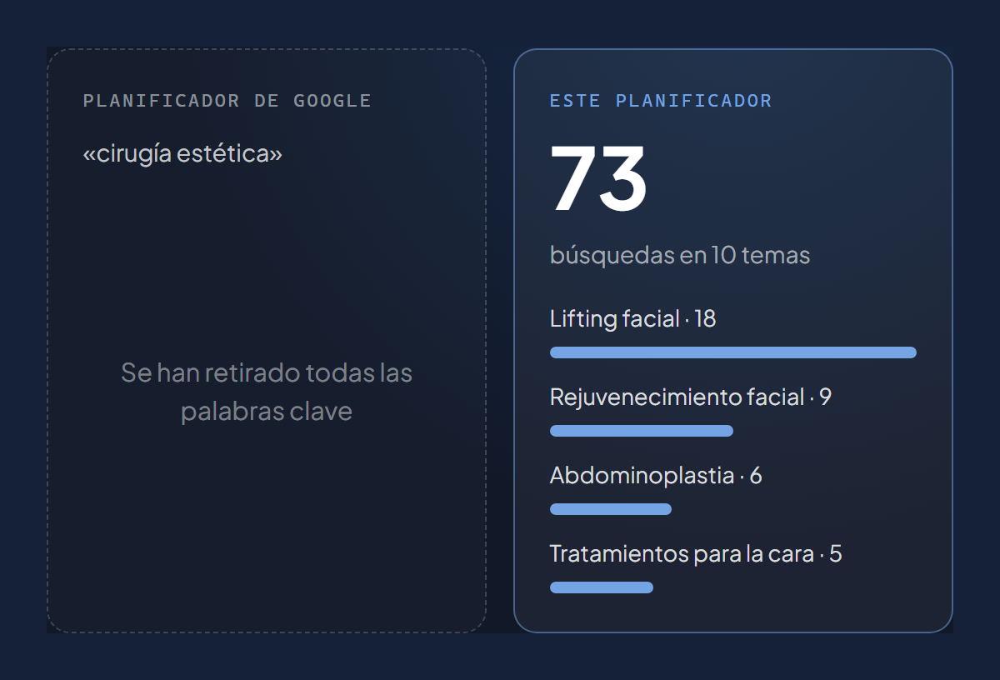

# Planificador de palabras clave para SEO

Una herramienta gratis de [DUPAVI](https://dupavi.es/recursos/planificador-palabras-clave/), hecha por Eduard Pampalona, consultor SEO.

Escribes una palabra clave y te devuelve las búsquedas relacionadas que hace la gente en Google, con su volumen, la tendencia, el CPC, la dificultad y la intención, ya agrupadas por tema. Es un cuaderno de Google Colab que usa los datos de DataForSEO: no instalas nada.

Todo sobre la herramienta, en su página: [dupavi.es/recursos/planificador-palabras-clave](https://dupavi.es/recursos/planificador-palabras-clave/).

## Para qué sirve

- **Ver qué busca la gente alrededor de un tema**, con cifras. Con «cirugía estética», el Planificador de Google retira la palabra y no da ninguna idea; este cuaderno saca 73 búsquedas con su volumen.
- **Ver los temas de un vistazo:** las búsquedas salen agrupadas, y cada grupo puede ser una página de tu web.
- **Filtrar sin gastar:** quitar lo que no es de tu negocio, quedarte con la intención comercial, ordenar por CPC, poner un volumen mínimo o separar las búsquedas que nombran otras ciudades.
- **Varios países a la vez:** lo que en España es «lifting facial», en México se busca como «estiramiento facial».
- **Descargarlo en Excel**, con el volumen de cada mes, el resumen de los grupos y las búsquedas que se han quitado, con el motivo; o en CSV.

## Qué necesitas

- Una cuenta de [DataForSEO](https://dataforseo.com/) con saldo. Cada búsqueda cuesta céntimos: de 3 a 17 céntimos de dólar por palabra y país, según cuántas ideas traiga (tarifa de noviembre de 2026). Al acabar, el cuaderno te dice lo que ha costado y el saldo que te queda.
- Las claves de la API: el login y la contraseña que salen en tu panel de DataForSEO, en «API Access». Ojo: no son tu correo ni la contraseña con la que entras en la web.

## Cómo se usa

1. Pulsa **Abrir en Colab** y guarda una copia en tu Drive: *Archivo > Guardar una copia en Drive*.
2. En tu copia, pulsa el icono de la llave (Secretos) y crea dos: `DATAFORSEO_LOGIN` y `DATAFORSEO_PASSWORD`, con «Acceso desde el cuaderno». Así tus claves no quedan escritas en el cuaderno.
3. Ejecuta el **paso 1**: te dice que estás conectado y el saldo que te queda.
4. Rellena el **paso 2** (palabras, países, idioma, profundidad y, si es local, la ciudad) y ejecútalo.
5. Filtra en el **paso 3**, que no gasta saldo, y descarga en el **paso 4**.

## Lo que no hace

- **No decide por ti.** Te da las búsquedas ordenadas; cuáles vale la pena trabajar depende de tu negocio, de tu web y de quién se lleva hoy esas búsquedas.
- **Los volúmenes son estimaciones** (datos de Google Ads, a través de DataForSEO). A veces la palabra principal no tiene volumen, y en algunos sectores casi no hay dato de dificultad: una dificultad 0 no quiere decir fácil.
- **En los temas que Google no deja anunciar** (por ejemplo, el CBD), Google no da el volumen de algunas búsquedas. Eso no quiere decir que nadie las busque. No salen en la tabla, pero no se pierden: están en la hoja «Descartadas» del Excel, con el motivo.
- **La intención y los grupos se calculan de forma automática:** revísalos antes de decidir nada.

Es una primera versión pública. Si echas algo en falta, abre una *issue*.

## ¿Lo quieres adaptado a tu empresa?

Si necesitas decidir qué búsquedas trabajar en tu web, o una herramienta pensada para tu caso, [cuéntamelo en dupavi.es](https://dupavi.es/recursos/planificador-palabras-clave/#formulario).

## Autor

Creado por:

- 🌐 Web: [https://dupavi.es](https://dupavi.es)  
- 💼 LinkedIn: [Eduard Pampalona Viladot](https://www.linkedin.com/in/eeduuu/)  
- ▶️ YouTube: [@dupavi](https://www.youtube.com/@dupavi)

   &nbsp;  &nbsp; 

## Licencia

MIT. Puedes usarlo, copiarlo y cambiarlo; solo tienes que mantener el aviso de autoría (archivo `LICENSE`).
